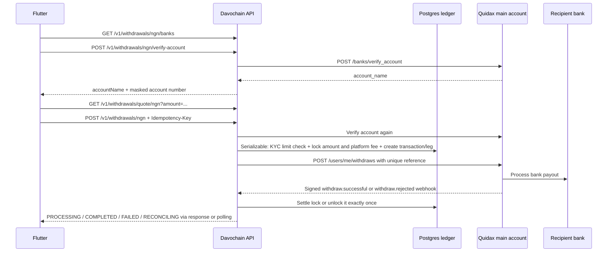

# Quidax NGN Bank Payout Flow

This note maps Quidax's documented NGN bank-withdrawal flow to Davochain's
current implementation. The feature is wired but **disabled by default** until
the live merchant account, treasury funding, fees, and webhook behavior are
verified.

## Quidax Contract

Quidax's documented sequence is:

1. `GET /banks` returns supported banks with `code`, `name`, `country`, and
   `currency`. Davochain filters to Nigeria + NGN.
2. `POST /banks/verify_account` resolves the account name. Request:

   ```json
   { "fund_uid": "0123456789", "fund_uid2": "100004", "currency": "ngn" }
   ```

   `fund_uid` is the account number; `fund_uid2` is the Quidax bank code. The
   response contains `data.account_name`. This operation verifies recipient
   details; it does not move funds.
3. `POST /users/me/withdraws` creates the payout from the merchant's **main
   Quidax account**. For a sub-account, the path would use that Quidax user ID,
   but Davochain NGN is a platform ledger liability, so the documented design
   uses `me`. Request:

   ```json
   {
     "currency": "ngn",
     "amount": "1000.00",
     "fund_uid": "0123456789",
     "fund_uid2": "100004",
     "transaction_note": "DavoChain withdrawal <transaction-id>",
     "narration": "DavoChain NGN withdrawal",
     "reference": "<unique-davochain-reference>"
   }
   ```

   The response includes Quidax withdrawal `id`, `reference`, `amount`, `fee`,
   `stamp_duty_fee`, `total`, and `status`. Quidax says creation is
   asynchronous; a successful HTTP response is not final payout settlement.
4. Wait for a signed webhook. Quidax documents `withdraw.successful` and
   `withdraw.rejected`. For an NGN `withdraw.successful` event, `data.status`
   may still be `Processing`; **the event name is the success signal**. Match
   by `data.reference` or `data.id`, deduplicate, and return HTTP 200 only after
   the event is durably accepted for processing.
5. If the webhook is missing, fetch the withdrawal by reference using
   `GET /users/{user_id}/withdraws/reference/{reference}`. For this payout,
   `{user_id}` is `me`. Keep unknown/pending results locked; only settle on a
   terminal provider result.

Official references:

- [Create Bank Withdraw](https://docs.quidax.io/reference/create-bank-withdrawal)
- [Verify Bank Account](https://docs.quidax.io/reference/verify-bank-account)
- [List banks](https://docs.quidax.io/reference/list-banks)
- [Fetch withdraw by reference](https://docs.quidax.io/reference/fetch-withdraw-by-reference)
- [Withdraw Successful webhook](https://docs.quidax.io/docs/withdraw-successful)
- [Withdraw Rejected webhook](https://docs.quidax.io/docs/withdraw-rejected)

The crypto fee endpoint `/users/me/fee_rule` is documented as a **crypto
withdrawal-fee** lookup; it is not used to estimate NGN bank fees. Quidax
returns bank payout fee and stamp duty after submission. Davochain's user quote
currently promises the bank amount plus Davochain's configured NGN fee; Quidax
fees are recorded as treasury cost. Finance must approve this policy and the
main account must have enough NGN reserve before enabling the feature.

## Davochain Execution Flow



### Current route and code map

| API/code | Behavior |
| --- | --- |
| `GET /v1/withdrawals/ngn/banks` | `WithdrawalsController.ngnBanks()` returns Quidax banks filtered to Nigeria/NGN. |
| `POST /v1/withdrawals/ngn/verify-account` | TIER_1-only; resolves the bank account and returns the name plus last four digits. Full account number is not returned or stored. |
| `GET /v1/withdrawals/quote/ngn` | Existing fee/KYC quote. `payoutAvailable` reflects `NGN_WITHDRAWALS_ENABLED`. |
| `POST /v1/withdrawals/ngn` | TIER_1 + `Idempotency-Key`; disabled unless `NGN_WITHDRAWALS_ENABLED=true`. It re-verifies account details, checks the limit inside the serializable lock transaction, stores a `BANK_PAYOUT` leg and calls Quidax main account. |
| `QuidaxClient.fetchBanks()` | Calls `GET /banks`. |
| `QuidaxClient.verifyBankAccount()` | Calls `POST /banks/verify_account`; read-only and safe to retry. |
| `QuidaxClient.createNgnBankWithdrawal()` | Calls `POST /users/me/withdraws`; ambiguous failures are not retried. |
| `SettlementService.applyWithdrawalWebhook()` | On success, consumes the lock and posts external payout/provider fee separately from platform margin. On rejection, unlocks and marks failed. NGN success uses event type, not `data.status`. |
| `ReconciliationService.resolveStuckLegs()` | Polls aged `SENT`/`UNKNOWN` bank payout legs by reference using `me`; processing remains open. |

`Transaction.fromAmount` is the total Davochain balance debit (bank amount plus
DavoChain fee); `Transaction.toAmount` is the bank payout amount and the amount
counted toward the user's NGN KYC daily limit. `feeAmount` is Davochain revenue;
`networkFee` records Quidax fee plus stamp duty. The transaction stores bank
name/code and account last four only, never the complete account number.

## Safety Gate and Rollout

- `NGN_WITHDRAWALS_ENABLED` defaults to `false`. Do not set it true in local or
  staging `.env` files just to test UI behavior.
- The mock provides a small bank catalogue, synthetic account-name resolution,
  a main-account NGN debit, and reference lookup. Use a signed/accepted mock
  webhook to drive final success/rejection; the mock's create response remains
  `processing`, as the real API is asynchronous.
- Do not accept client-provided account names. The API resolves the name again
  at payout submission; Flutter must display the name to the user before they
  confirm.
- The API locks the Davochain ledger balance before calling Quidax. An
  unambiguous rejection unlocks; timeout/unknown remains `RECONCILING`; never
  refund an unknown outcome.
- Provider fees can exceed Davochain's platform fee. The ledger represents
  that difference as a debit to the platform revenue account; review admin
  earnings/reporting so provider charges are visible as payout costs.
- Before production enablement, verify the merchant's NGN main wallet has
  payout reserve separate from buy-fallback fuel; confirm real fees, minimums,
  maximums, settlement timing, signed webhooks, and the bank-name behavior with
  low-value tests.
- Run duplicate-webhook, duplicate-idempotency, provider timeout, process
  restart, rejected payout, and by-reference reconciliation tests before
  enabling the flag.
